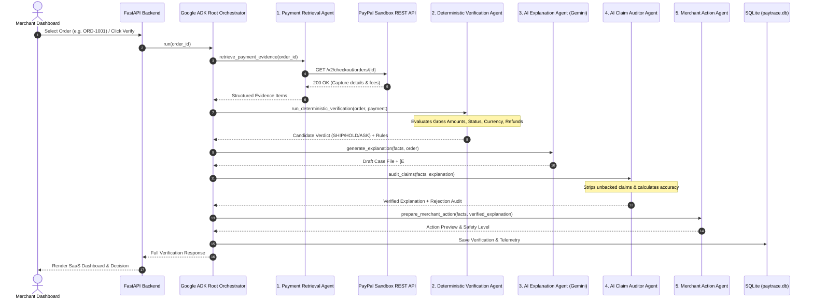

# PayTrace System Architecture

## 1. Architectural Principles

1. **Deterministic Verdict Supremacy**: 
   The payment verdict (`SHIP`, `HOLD`, `ASK`) is computed purely by deterministic Python code adhering to strict banking rules. The LLM has zero authority to overturn the verdict.

2. **Verifiable Citations**:
   Every factual explanation generated by Gemini must cite a ground-truth evidence tag (`[E1]`, `[E2]`).

3. **Autonomous Claim Auditing**:
   An independent fact-checking agent reviews every claim produced by the AI Explainer against raw PayPal response data, deleting unsupported claims and reporting verification metrics.

4. **Human-in-the-Loop Financial Safety**:
   Merchant actions (fulfillments, hold notices, sandbox refunds) require manual review and an explicit modal confirmation checkbox. No automated financial execution is permitted.

---

## 2. Multi-Agent Interaction Flow

---

## 3. Deterministic Verification Rules

| Rule Name | Condition | Result | Justification |
|:---|:---|:---:|:---|
| `NO_PAYMENT_FOUND` | No capture or authorization in PayPal | `HOLD` | Cannot fulfill without payment records. |
| `RULE_CAPTURE_STATUS_HOLD` | Status is `PENDING`, `HELD`, or not `COMPLETED` | `HOLD` | Funds have not cleared PayPal underwriting. |
| `RULE_REFUND_STATUS_HOLD` | Refund amount > 0 or status `REFUNDED` | `HOLD` | Money was returned to customer. |
| `RULE_CURRENCY_MATCH_HOLD` | Capture currency != Order currency | `HOLD` | Cross-border FX risk or merchant currency mismatch. |
| `RULE_AMOUNT_MATCH_HOLD` | Gross captured < Order total | `HOLD` | Partial payment received. |
| `RULE_AMOUNT_MATCH_ASK` | Gross captured > Order total | `ASK` | Overpayment detected; check for tip or billing error. |
| `RULE_REFERENCE_MATCH_ASK` | PayPal Invoice ID != Order ID | `ASK` | Risk of payment misattribution. |
| `RULE_ALL_CHECKS_PASSED_SHIP`| All checks OK | `SHIP` | Verified, captured, matching reference and amount. |

### Note on PayPal Fees
PayPal transaction fees (deducted in `seller_receivable_breakdown.paypal_fee`) represent merchant processing overhead, **not an order shortfall**. PayTrace validates that `gross_amount == order_total`, treating `net_amount` as informational.
